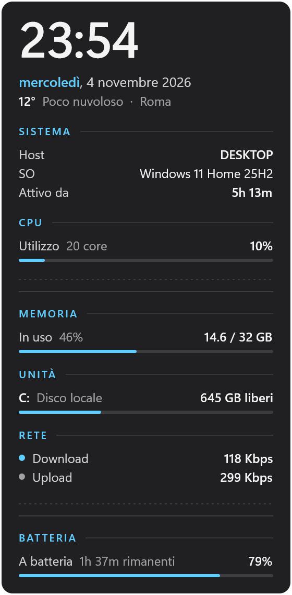

# Essentials for Vitrine

A single widget for [Vitrine](https://github.com/vitrine-org/vitrine), **Conky**: one tall column in
the spirit of Conky, in the Windows 11 style.



- Time and date, with an optional weather line from [Open-Meteo](https://open-meteo.com).
- **System**: host, Windows version, uptime.
- **CPU**: usage and cores, a bar and a history chart.
- **Memory**: used of total, with a bar.
- **Drives**: free space and a bar for each drive.
- **Network**: download and upload rates with a history chart.
- **Battery**: charge and state, on devices that have one.

Every section can be turned off. Sizes run from 3×6 to 5×10 cells (default 4×8). When the column
is short, the charts go first, then extra drives, then sections from the bottom. It comes as an
acrylic card or with no background, drawn straight on the wallpaper with a shadow that keeps the
text readable. Light and dark follow Windows live (Theme: System), or pick one. The accent follows
Windows too, or you can pick your own.

Settings, the widget name and description, and the texts inside the widget are translated into
Italian, French, German, Spanish, Brazilian Portuguese, Simplified Chinese, Russian, Japanese and
Korean. The settings use `titles` / `labels` maps in `settings.json`, the name and description use
`locales` in `vitrine.json`, and the texts inside the widget are in `src/shared/i18n.ts`, picked
from the Windows locale.

Essentials 3.0 contains only Conky. The other widgets (Clock, Calendar, System, Network, Battery,
Weather, Analog Clock, To Do, Note, Links, Drives, Countdown, Progress) were removed. They are
still in the [2.2.1 release](https://github.com/vitrine-org/essentials/releases/tag/v2.2.1).

## Build

```sh
npm install
npm run pack      # → essentials-3.0.0.vitrine
```

Preview: `vitrine render dist conky --cells 4x8 --network --settings '{"showWeather":true}' --out conky.png`.

To regenerate `src/conky/preview.png`, run `py scripts/previews.py` after `npm run build` (needs
Pillow and `vitrine.exe`). It renders the dark theme at the default size on a transparent
background, cut to the card's rounded shape just inside its hairline edge (no rim, shadow or glow).

## License

MIT
