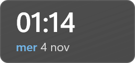
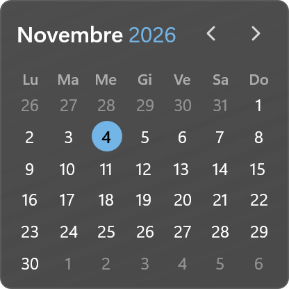
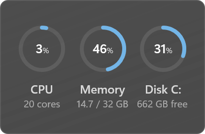
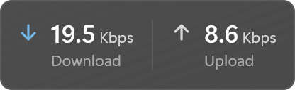
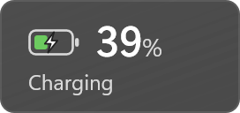
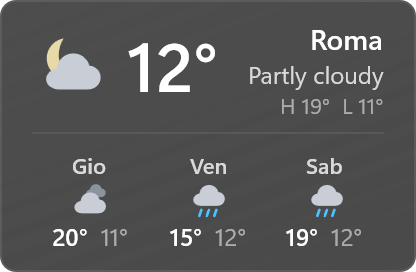

# Essentials for Vitrine

The everyday widgets for [Vitrine](https://github.com/vitrine-widgets/vitrine), in the Windows 11 style.
Every widget comes as an acrylic card or with no background at all, drawn straight on the wallpaper with
shadows that keep it readable. Theme and accent follow Windows, or pick your own.

| Widget | Size | |
|---|---|---|
| **Clock**: time and date in your locale, 12/24-hour | 2×1 to 4×2 |  |
| **Calendar**: month view, today highlighted, previous and next month | 3×3 to 4×4 |  |
| **System**: CPU, memory and disk as rings or bars | 3×2 to 4×2 |  |
| **Network**: download and upload speed | 3×1 to 4×1 |  |
| **Battery**: charge level, charging state, time left | 2×1 to 3×1 |  |
| **Weather**: current conditions and 3 days from [Open-Meteo](https://open-meteo.com), works offline from cache | 3×2 to 4×2 |  |

## Build

```sh
npm install
npm run pack      # → essentials-2.0.0.vitrine
```

`package.json` points `@vitrine/sdk` at `file:../vitrine-sdk` for local builds. Releases use
`github:vitrine-widgets/sdk#v2.0.0`.

Preview a widget: `vitrine render dist weather --cells 3x2 --network --out weather.png`.

## License

MIT
