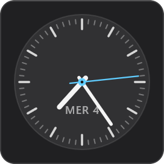
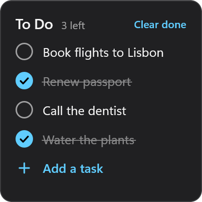
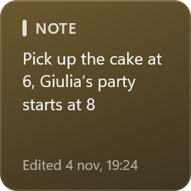
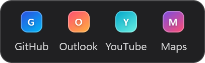
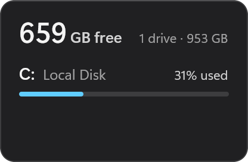
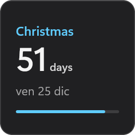
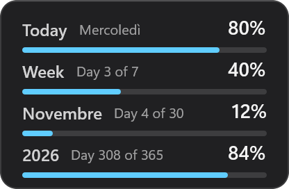

# Essentials for Vitrine

The everyday widgets for [Vitrine](https://github.com/vitrine-org/vitrine), in the Windows 11 style.
Every widget comes as an acrylic card, frosted glass that blurs and saturates the wallpaper behind it,
or with no background at all, drawn straight on the wallpaper with shadows that keep it readable.
Light and dark follow Windows live (Theme: System), or pick one; the accent follows Windows too, or
pick your own.

| Widget | Size | |
|---|---|---|
| **Clock**: time and date in your locale, 12/24-hour | 2×1 to 4×2 |  |
| **Calendar**: month view, today highlighted, previous and next month | 3×3 to 4×4 |  |
| **System**: CPU, memory and disk as rings or bars | 3×2 to 4×2 |  |
| **Network**: download and upload speed | 3×1 to 4×1 |  |
| **Battery**: charge level, charging state, time left | 2×1 to 3×1 |  |
| **Weather**: current conditions and 3 days from [Open-Meteo](https://open-meteo.com), works offline from cache | 3×2 to 4×2 |  |
| **Analog Clock**: dial with ticks, numerals or minimal, sweeping second hand | 2×2 to 4×4 |  |
| **To Do**: click a task to check it off, clear the done ones, add and edit tasks in place | 2×2 to 4×4 |  |
| **Note**: a sticky note in five tints, click to edit | 2×2 to 4×4 |  |
| **Links**: up to eight sites, one click to open | 2×1 to 4×2 |  |
| **Drives**: free space on every drive | 3×1 to 4×4 |  |
| **Countdown**: days left to a date, or to New Year | 2×1 to 4×2 |  |
| **Progress**: how much of the day, week, month and year has gone, as bars or rings | 3×2 to 4×2 |  |

To Do and Note type through Vitrine's text flyout where the engine has it; otherwise enter tasks
and text in the widget settings.

## Build

```sh
npm install
npm run pack      # → essentials-2.1.2.vitrine
```

`package.json` depends on `github:vitrine-org/sdk#v2.1.0`, which provides `prompt()` for the to-do
and note text entry.

Preview a widget: `vitrine render dist weather --cells 3x2 --network --out weather.png`.

Regenerate every `src/<widget>/preview.png` after `npm run build` with `py scripts/previews.py` (needs Pillow and `vitrine.exe`): same theme, accent and default size for all widgets, on a transparent background, cut to the card's rounded shape over a flat neutral backdrop, so the gallery, store and website show them alike on a neutral tile.

## License

MIT
